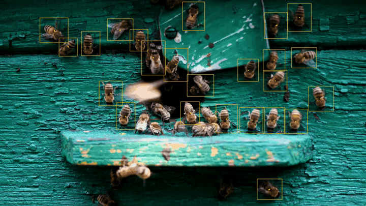
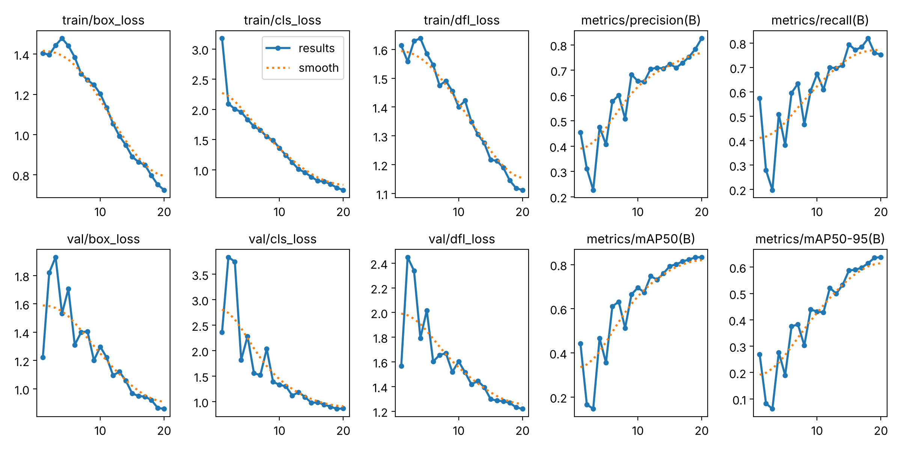
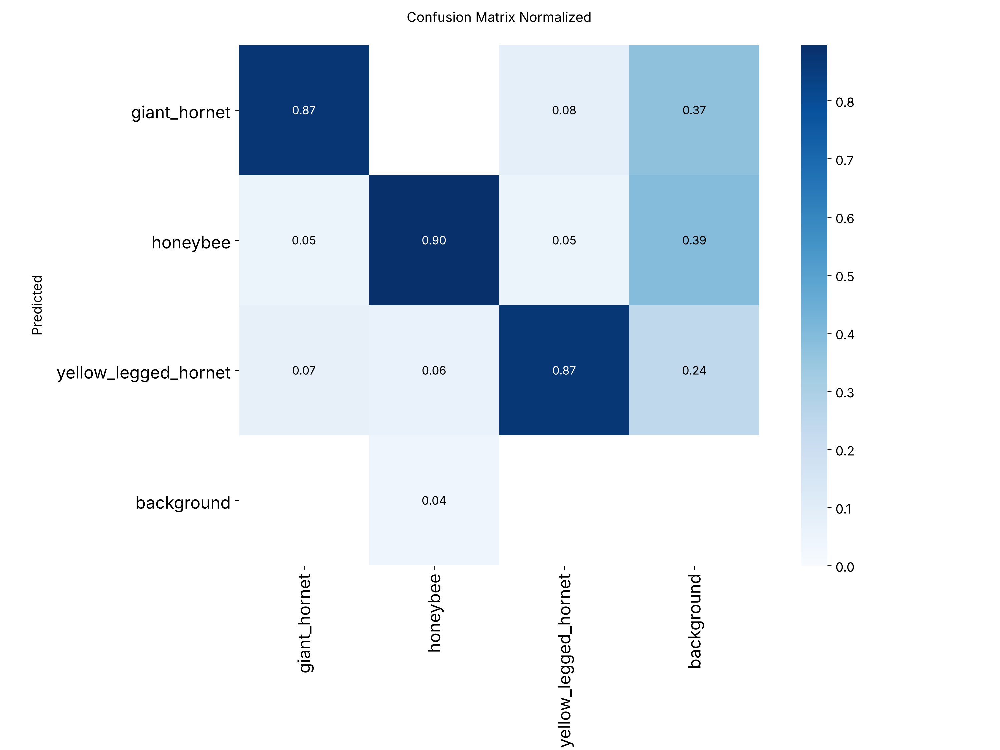
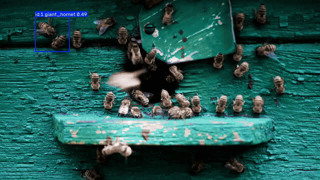
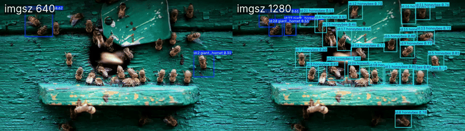
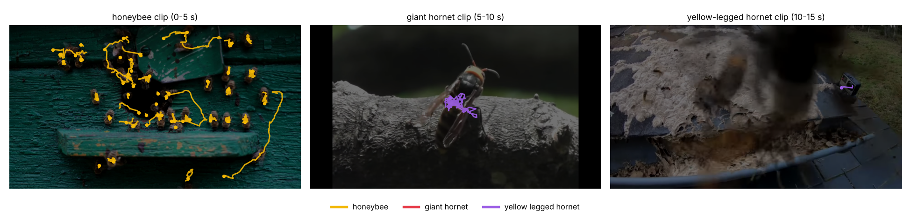
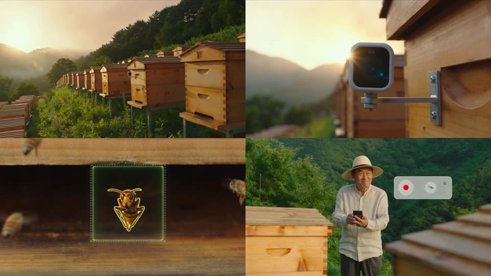

# BeeGuard: 꿀벌·장수말벌·등검은말벌 탐지와 추적

직접 모으고 라벨링한 데이터로 YOLOv8을 학습해, 영상에서 꿀벌과 두 종의 말벌을 찾고 추적합니다. 추적한 궤적은 파일로 저장하고, 말벌이 한자리에 떠 있으면 정지비행(HOVER)으로 표시합니다. 충북대학교 머신러닝 과제로 진행했습니다. 점수가 잘 나오는 쉬운 주제 대신, 여름방학에 구상한 양봉장 말벌 대응 시스템(BeeGuard)의 첫 단계를 직접 만들어 보는 쪽을 택했습니다.

[](videos/beeguard_tracking.mp4)

벌통 입구의 꿀벌을 한 마리씩 탐지하고 궤적을 그리는 장면입니다(결과 영상의 처음 5초). 누르면 15초 전체 영상으로 이동합니다.

[결과 영상](videos/beeguard_tracking.mp4) · [학습 모델](models/best.pt) · [결과보고서 PDF](report/result_report.pdf)

## 결과

테스트 세트 143장 기준입니다. Colab 무료 GPU를 할당받지 못해 CPU(4코어)에서 학습했습니다.

| 실험 | 입력 크기 | epoch | Precision | Recall | mAP50 | mAP50-95 | CPU 추론 |
| --- | --- | --- | --- | --- | --- | --- | --- |
| n320 | 320 | 12 | 0.664 | 0.670 | 0.731 | 0.484 | 8.7 ms |
| **n640 (최종)** | 640 | 20 | 0.781 | 0.763 | 0.859 | 0.635 | 28.6 ms |
| n640 + 추가 15 epoch | 640 | 35 | 0.764 | 0.806 | 0.838 | 0.649 | 32.4 ms |
| 두 모델 가중치 평균 | 640 | | 0.847 | 0.744 | **0.864** | **0.661** | 28.6 ms |

최종 모델(n640)의 부류별 AP50은 장수말벌 0.827, 꿀벌 0.881, 등검은말벌 0.868이고, 장수말벌을 등검은말벌로 잘못 본 비율은 9.1%(5/55), 반대는 10.5%(4/38)였습니다. 두 모델의 가중치를 평균 낸 모델([`models/soup.pt`](models/soup.pt))은 테스트 점수가 가장 높았지만 실제 영상에서 오탐이 늘어 최종으로 쓰지 않았습니다. 추적 영상은 작게 찍힌 꿀벌을 잡기 위해 추론 입력을 1280으로 키워 만들었습니다. 모델 후보는 검증 세트 mAP50-95로 비교했고(평균 모델 0.668, n640 0.638, n320 0.454), 표의 숫자는 학습과 선택에 쓰지 않은 테스트 세트 결과입니다.

<p>


</p>

왼쪽은 학습·검증 세트의 학습 곡선, 오른쪽은 테스트 세트의 정규화 혼동 행렬입니다.

| 파일 | 내용 |
| --- | --- |
| [`results/experiments.csv`](results/experiments.csv) | 실험별 성능과 부류별 AP50 |
| [`results/test_confusion_counts.csv`](results/test_confusion_counts.csv) | 테스트 세트 혼동 행렬 (정답 × 예측, 놓침·오탐 포함) |
| [`results/failure_cases.jpg`](results/failure_cases.jpg) | 종을 헷갈린 사진 모음 |
| [`results/detection_timeline.png`](results/detection_timeline.png) | 영상의 시간별 탐지 수와 정지비행 구간 |

## 전체 결과 영상

꿀벌 → 장수말벌 → 등검은말벌 구간을 이은 15초 영상입니다. 꿀벌은 얇은 박스와 궤적만, 말벌은 이름과 추적 ID를 함께 표시했습니다. 추적 결과에 두 가지 후처리를 했습니다([`scripts/render_tracks.py`](scripts/render_tracks.py)). 10프레임 미만으로 끊긴 짧은 트랙은 그리지 않고, 트랙마다 프레임별 종 판정을 다수결로 모아 한 종으로 표시합니다. 이것만으로 꿀벌 구간에서 꿀벌을 장수말벌로 잘못 표시하던 박스 62개가 모두 사라졌습니다. 장수말벌을 등검은말벌로 판정하는 오류와 등검은말벌 구간에서 거의 잡지 못하는 한계는 남아 있습니다.



## 시각화

입력 크기에 따른 차이 (같은 n640 모델, 꿀벌 구간). 640에서는 꿀벌 무리를 장수말벌 하나로 묶고, 1280에서는 한 마리씩 잡습니다.



구간별 궤적 지도 ([`logs/tracks.csv`](logs/tracks.csv)를 그린 것, 점은 트랙 시작 위치)



## 부류

| 라벨 | 대상 |
| --- | --- |
| `giant_hornet` | 장수말벌 (*Vespa mandarinia*) |
| `honeybee` | 꿀벌 (*Apis mellifera*) |
| `yellow_legged_hornet` | 등검은말벌 (*Vespa velutina nigrithorax*) |

꽃등에, 쌍살벌, 호박벌처럼 비슷하게 생긴 곤충과 빈 벌통·꽃밭 사진은 박스 없이 넣어 오탐을 줄였습니다. 부류별 구별 기준은 [`docs/labeling_guide.md`](docs/labeling_guide.md)에 있습니다.

## 데이터셋

| 부류 | 수집 | 정제 후 | 라벨 검수 후 | 박스 수 |
| --- | --- | --- | --- | --- |
| honeybee | 2,013 | 432 | 397 | 486 |
| giant_hornet | 1,687 | 529 | 489 | 575 |
| yellow_legged_hornet | 1,787 | 385 | 347 | 371 |
| 비슷한 곤충 · 배경 | 1,803 · 293 | 152 · 38 | 152 · 38 | 0 |

과제 조건에 따라 라벨이 달린 공개 데이터셋은 쓰지 않았습니다. iNaturalist, GBIF, Wikimedia Commons, Openverse, 네이버, Bing, DuckDuckGo, Baidu에서 모은 뒤 중복과 저품질 사진을 지우고 손으로 검수했습니다. 박스는 Grounding DINO로 먼저 만들고, 번호를 붙인 검수 시트로 AI 검수를 해 고쳤습니다([`labeling/`](labeling/)). 최종 분할은 Train 996 / Valid 284 / Test 143장입니다. 이미지는 저작권 때문에 저장소에 올리지 않았습니다.

## 추적과 궤적

[`scripts/track_trajectory.py`](scripts/track_trajectory.py)가 `model.track(persist=True)`와 ByteTrack으로 객체를 추적하고, 화면에 궤적을 그리면서 아래 파일을 남깁니다.

| 파일 | 내용 |
| --- | --- |
| `logs/tracks.csv` | 프레임별 추적 ID, 부류, 중심 좌표, 박스 크기, 이동 속도, 정지비행 여부 |
| `logs/detections.csv` | 새 객체 등장과 말벌 정지비행 시작 이벤트 |
| `logs/summary.json` | 부류별 고유 객체 수, 정지비행 이벤트 수, 부류가 바뀐 트랙 수 |

정지비행은 최근 1초 동안의 순 이동 속도가 초당 몸길이(박스 긴 변) 1배 이하인 상태가 1초 넘게 이어질 때로 정했습니다. 등검은말벌이 벌통 앞에 떠서 사냥하는 행동을 잡기 위한 규칙이며, 2D 영상만으로는 앉아 있는 개체와 떠 있는 개체를 구분하지 못합니다.

## 실행 방법

노트북은 Colab에서 순서대로 실행합니다.

1. [`01_collect_and_clean`](notebooks/01_collect_and_clean.ipynb): 사진 수집, 정제, 출처 기록
2. [`01b_auto_label`](notebooks/01b_auto_label.ipynb): Grounding DINO 자동 라벨, 검수 수정 적용, Train/Valid/Test 분할
3. [`02_train`](notebooks/02_train.ipynb): 학습, 테스트 평가, 혼동 분석
4. [`03_track`](notebooks/03_track.ipynb): 추적 영상, 궤적 로그, 그래프

GPU가 없으면 02 노트북 대신 같은 코드를 로컬에서 실행할 수 있습니다.

```bash
pip install ultralytics
python scripts/train_local.py --data <dataset_split 폴더> --run n640 --epochs 20
python scripts/track_trajectory.py --model models/best.pt --source videos/clips/test.mp4 --out videos/out.mp4 --imgsz 1280
```

## 저장소 구조

```
notebooks/   01 수집·정제 → 01b 자동 라벨링·검수·분할 → 02 학습 → 03 추적
scripts/     track_trajectory.py, train_local.py, video_tools.py, label_size_stats.py, report_pdf.js 등
labeling/    AI 검수 결과 (corrections.json, 판정 이유, 직접 고쳐야 할 사진 목록)
models/      best.pt
results/     실험표, 학습 곡선, 혼동 행렬, 실패 사례, 그래프, GIF
logs/        추적 로그
videos/      결과 영상
report/      결과보고서 (report_draft.md → result_report.pdf)
```

## 지향하는 모습 (AI 생성 콘셉트 영상)

이 저장소는 양봉장 말벌 대응 시스템 BeeGuard의 첫 단계입니다. 최종적으로 그리는 모습을 영상 생성 AI(Renoise, Seedance 2.5)로 만든 15초 콘셉트 영상으로 남겼습니다. 실제 촬영이나 이 모델의 탐지 결과가 아닙니다.

[](videos/beeguard_vision_concept.mp4)

## 한계

- 웹 사진은 대부분 가까이서 찍은 것이라, 벌이 작게 찍히는 실제 양봉장 영상과 차이가 큽니다.
- 라벨은 AI 검수까지만 거쳤고, 박스 크기 조정이 필요한 17장과 자동 박스가 없던 22장은 직접 고치지 못했습니다.
- 추적 영상은 공개 클립을 이어 붙인 것이라 세 부류가 한 화면에 함께 나오지 않고, 실제 벌통 입구 환경을 그대로 보여 주지도 않습니다. 재사용 조건이 분명한 그런 영상은 찾지 못했습니다.
- 등검은말벌 구간은 말벌이 작고 흐려서 거의 잡지 못했습니다.

## 출처

영상 클립 (03 노트북이 내려받아 5초씩 이어 붙임)

| 구간 | 출처 | 작성자 | 라이선스 |
| --- | --- | --- | --- |
| 꿀벌 0:00–0:05 | [Mixkit: Bees at the entrance of the beehive](https://mixkit.co/free-stock-video/bees-at-the-entrance-of-the-beehive-25173/) | azgek | Mixkit Stock Video Free License |
| 장수말벌 1:26–1:31 | [Wikimedia Commons: Japanese giant hornet.webm](https://commons.wikimedia.org/wiki/File:Japanese_giant_hornet.webm) | The Nature Box | CC BY-SA 3.0 |
| 등검은말벌 2:40–2:45 | [Wikimedia Commons: Un frelon COINCE son DARD dans ma GoPro.webm](https://commons.wikimedia.org/wiki/File:Un_frelon_COINCE_son_DARD_dans_ma_GoPro.webm) | DD Frelons | CC BY 3.0 |

관련 연구

- Jeon, M.-S. et al. (2023). Deep learning-based portable image analysis system for real-time detection of *Vespa velutina*. *Applied Sciences, 13*(13), 7414.
- O'Shea-Wheller, T. A. et al. (2024). VespAI: A deep learning-based system for the detection of invasive hornets. *Communications Biology*. https://doi.org/10.1038/s42003-024-05979-z
- Hall, H. et al. (2025). Remote and automated detection of Asian hornets at an apiary, using spectral features of their hovering flight sounds. *Computers and Electronics in Agriculture, 235*, 110307.
- Ultralytics YOLOv8: https://github.com/ultralytics/ultralytics

## 라이선스

코드는 [MIT License](LICENSE)를 따릅니다. 학습과 추론에 쓴 Ultralytics YOLOv8은 AGPL-3.0 라이선스입니다. 학습 이미지는 포함하지 않습니다. 결과 영상은 CC BY-SA 3.0 클립을 포함하므로 같은 CC BY-SA 3.0으로 공개합니다.
