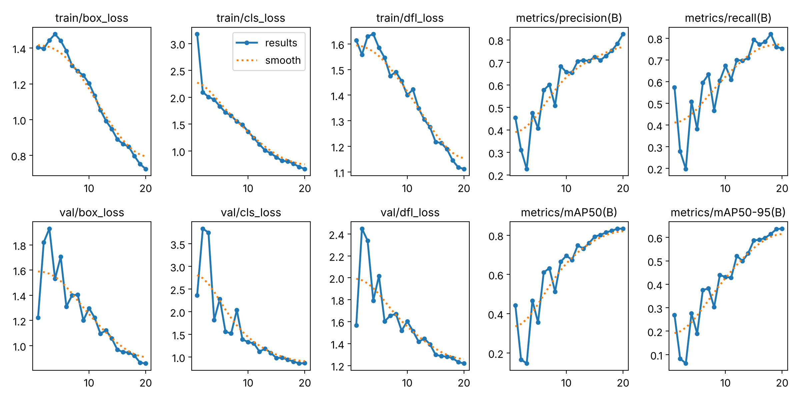
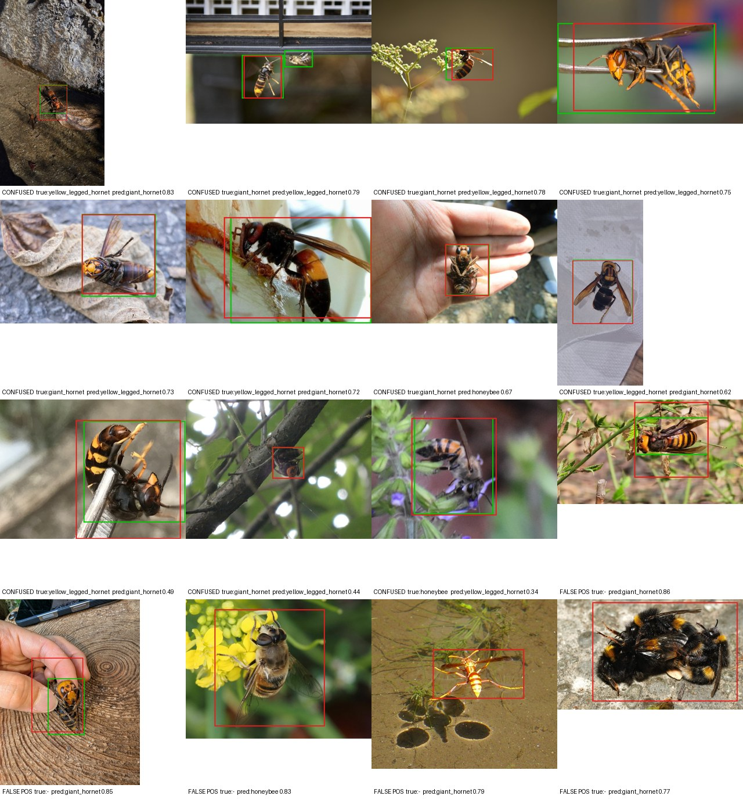
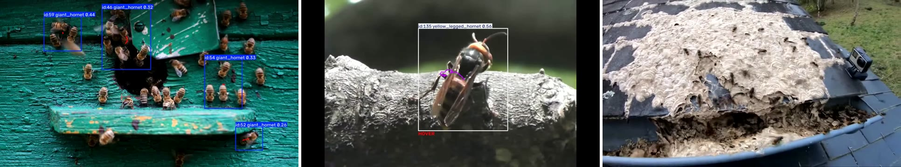
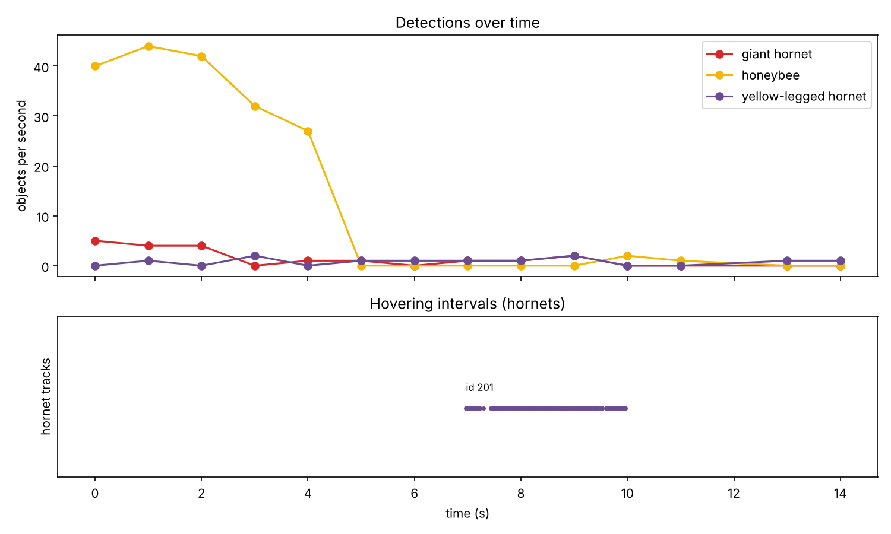

# YOLOv8 기반 꿀벌·장수말벌·등검은말벌 탐지 및 추적 결과보고서

> 원고. PDF는 `node scripts/report_pdf.js`로 `report/result_report.pdf`에 만든다.

- 학번·이름: 2022041067 이성준
- 과목: 머신러닝 (충북대학교 소프트웨어학부)

## 1. 학습 과정 및 성능

### 1.1 주제와 부류

여름방학 동안 카메라로 양봉장의 말벌을 찾아내고 대응하는 시스템(BeeGuard)을 구상한 적이 있다. 그때 탐지 모델 후보로 YOLO 계열을 알아봤는데, 수업에서 YOLO를 다루면서 이 과제를 그 첫 단계로 삼기로 했다. 이번 과제의 목표는 양봉장 시스템 전체가 아니라 그 바탕이 되는 탐지·추적 모델을 직접 만들어 보는 것이다. 국내 양봉장에서 문제가 되는 말벌은 장수말벌과 등검은말벌 두 종이고, 이 둘을 꿀벌과 구분해야 하므로 부류를 다음 세 개로 정했다.

| 라벨 | 대상 | 고른 이유 |
| --- | --- | --- |
| `giant_hornet` | 장수말벌 (*Vespa mandarinia*) | 여러 마리가 한꺼번에 벌통을 습격한다 |
| `honeybee` | 꿀벌 (*Apis mellifera*) | 지켜야 할 대상이라 말벌과 헷갈리면 안 된다 |
| `yellow_legged_hornet` | 등검은말벌 (*Vespa velutina nigrithorax*) | 벌통 앞에 떠 있다가 나오는 꿀벌을 잡아간다 |

꽃등에, 쌍살벌, 호박벌처럼 생김새가 비슷한 곤충과 빈 벌통·꽃밭 사진은 박스 없는 이미지로 함께 넣었다. 비슷한 곤충을 말벌로 잘못 잡는 일을 줄이려는 목적이다.

### 1.2 데이터 수집과 정제

라벨이 달린 공개 데이터셋은 쓰지 않고 사진을 직접 모았다. iNaturalist, GBIF, Wikimedia Commons, Openverse에서는 학명으로, 네이버는 한국어, Bing과 DuckDuckGo는 영어, Baidu는 중국어로 검색해 모두 9개 경로에서 7,583장을 받았다. 깨진 파일, 너무 작은 사진(짧은 변 320px 미만), 중복 사진을 자동으로 지운 다음, 번호를 붙인 미리보기를 보면서 1,164장을 손으로 더 지웠다. 둥지만 찍힌 사진, 표본과 말벌주, 일러스트, 워터마크가 있는 스톡 사진, 다른 종이 주로 지워졌다.

| 구분 | 수집 | 정제 후 | 라벨 검수 후 | 박스 수 |
| --- | --- | --- | --- | --- |
| honeybee | 2,013 | 432 | 397 | 486 |
| giant_hornet | 1,687 | 529 | 489 | 575 |
| yellow_legged_hornet | 1,787 | 385 | 347 | 371 |
| 비슷한 곤충 · 배경 | 1,803 · 293 | 152 · 38 | 152 · 38 | 0 |
| 합계 | 7,583 | 1,536 | 1,423 | 1,432 |

남은 사진의 약 70%는 iNaturalist와 GBIF의 야외 관찰 사진이다. 사진마다 원본 URL을 기록했고(라이선스·작성자까지 확인된 것은 1,147장), 저작권 때문에 이미지 자체는 저장소에 올리지 않았다.

### 1.3 라벨링

1,300장이 넘는 사진에 박스를 직접 그리기에는 시간이 부족해서, 글자로 대상을 지정하는 탐지 모델 Grounding DINO로 `"bee. wasp. hornet."`을 찾게 해 초기 박스를 만들었다. 이 모델은 두 말벌 종을 구분하지 못하기 때문에 박스 위치만 쓰고, 클래스는 사진이 들어 있던 폴더 이름으로 정했다. 말벌 사진에 같이 찍힌 작은 꿀벌만 honeybee로 바꿨다.

자동 박스에는 오류가 꽤 있었다. 박스마다 번호를 붙인 검수용 시트 111장(사진 1,324장)을 만들어 Claude(AI)에게 검토를 맡겼고, 지울 박스, 클래스를 바꿀 박스, 뺄 사진을 목록(`labeling/corrections.json`)으로 받아 노트북에서 한 번에 적용했다. 그 결과 사진 91장을 빼고, 102장에서 박스 144개를 지우고, 박스 29개의 클래스를 고쳤다. 원래는 Roboflow에서 사람이 한 번 더 다듬을 계획이었지만 시간이 모자라 이 단계는 하지 못했다. 그래서 박스 크기 조정이나 빠진 개체 추가가 필요하다고 표시된 17장은 그대로 들어갔고, 자동 박스를 하나도 찾지 못한 22장은 뺐다.

최종 데이터는 사진 1,423장(박스 없는 사진 190장 포함)이고, 부류별로 무작위로 나눠 Train 996장, Valid 284장, Test 143장으로 썼다. 증강은 따로 만들지 않고 YOLOv8 학습 때의 기본 증강만 사용했다.

### 1.4 학습 설정

COCO로 사전학습된 YOLOv8n에서 전이학습했다(batch 16, seed 0). Colab 무료 GPU가 사용량 제한으로 잡히지 않아 학습은 CPU(4코어)에서 했고, 그 때문에 epoch 수를 줄였다(3.4절). 입력 크기가 성능에 주는 영향을 보려고 320(12 epoch)과 640(20 epoch)을 비교했다. 960·1280 입력, YOLOv8s, 색상 증강 실험도 노트북에 넣어 두었지만 GPU가 없어 돌리지 못했다.

### 1.5 성능 (테스트 세트 143장)

| 실험 | 입력 | epoch | Precision | Recall | mAP50 | mAP50-95 | AP50 장수말벌 | AP50 꿀벌 | AP50 등검은말벌 | CPU 추론 |
| --- | --- | --- | --- | --- | --- | --- | --- | --- | --- | --- |
| n320 | 320 | 12 | 0.664 | 0.670 | 0.731 | 0.484 | 0.725 | 0.772 | 0.696 | 8.7 ms |
| n640 | 640 | 20 | 0.781 | 0.763 | 0.859 | 0.635 | 0.827 | 0.881 | 0.868 | 28.6 ms |

입력을 640으로 키운 n640이 모든 지표에서 앞섰고, 특히 등검은말벌 AP50이 0.696에서 0.868로 가장 많이 올랐다. epoch을 더 돌린 영향도 섞여 있어서 입력 크기만의 효과라고 단정하기는 어렵다. 추론 시간은 이미지당 8.7ms에서 28.6ms로 세 배 남짓 늘었다. 최종 모델은 n640으로 정했다(`models/best.pt`). 테스트 세트로 모델을 고르면 테스트 점수가 부풀 수 있어 검증 세트 기준도 확인했는데, 검증 mAP50-95도 n640이 0.638로 n320(0.454)보다 높았다.

데이터셋 사진을 640 크기로 줄여도 박스 1,432개 중 1,431개가 32px 이상이었다(`results/label_size_stats.csv`). 웹 사진은 대부분 가까이서 찍은 것이라 작은 객체가 거의 없다. 그런데 1.7절의 추적 영상에서는 벌이 화면에 작게 나와서, 테스트 점수만으로는 보이지 않던 문제가 드러났다.

### 1.6 혼동 분석과 실패 사례

n640 모델로 테스트 세트를 다시 예측하고, 정답 박스와 IoU 0.5 이상 겹치는 예측끼리 짝지어 세었다(conf 0.25 이상).

| | 예측: 장수말벌 | 예측: 꿀벌 | 예측: 등검은말벌 | 놓침 |
| --- | --- | --- | --- | --- |
| 정답: 장수말벌 (55) | 39 | 1 | 5 | 10 |
| 정답: 꿀벌 (48) | 0 | 38 | 1 | 9 |
| 정답: 등검은말벌 (38) | 4 | 0 | 32 | 2 |
| 정답 없음 (오탐) | 11 | 6 | 10 | |

장수말벌을 등검은말벌로 본 경우가 5/55(9.1%), 반대가 4/38(10.5%)였다. n320에서는 등검은말벌을 장수말벌로 본 경우가 6/38(15.8%)이었으니 이쪽이 조금 줄었다. 꿀벌을 말벌로 본 경우는 1/48뿐이었다.

종을 헷갈린 사진은 옆이나 뒤에서 찍혀 머리 색(장수말벌은 주황색 머리, 등검은말벌은 검은 머리에 주황 얼굴)과 배 무늬가 잘 안 보이거나, 핀셋이나 손에 잡힌 표본 사진, 또는 화면에서 작게 찍힌 경우가 많았다. 오탐 27건 중에는 박스 없이 넣었던 비슷한 곤충이 눈에 띄었다. 꽃등에를 꿀벌로, 쌍살벌과 호박벌을 장수말벌로 본 경우다. 종은 맞게 찾았지만 예측 박스가 라벨 박스보다 훨씬 커서(IoU 0.5 미만) 오탐과 놓침으로 한 번씩 세어진 경우도 있었다. 등검은말벌 폴더에 장수말벌로 보이는 사진이 섞여 있는 등, 웹에서 모은 라벨 자체의 오류도 남아 있었다.

### 1.7 탐지·추적 영상

라이선스가 확인된 공개 영상 세 개를 5초씩 잘라 15초 영상을 만들었다. 꿀벌은 Mixkit의 벌통 입구 영상, 장수말벌은 Wikimedia Commons의 The Nature Box 영상(CC BY-SA 3.0), 등검은말벌은 Wikimedia Commons의 DD Frelons 영상(CC BY 3.0)이다.

추적은 `model.track(persist=True)`에 ByteTrack을 썼다. ByteTrack은 외형 특징(re-ID) 없이 박스 위치와 움직임만으로 ID를 이어 준다. 강의에서 소개한 Ultralytics 예제는 객체 중심점을 화면에 선으로 그리기만 하고 저장하지 않아서, 프레임마다 ID, 중심 좌표, 속도, 정지비행 여부를 `logs/tracks.csv`에 따로 저장하도록 코드를 고쳤다. 말벌이 최근 1초 동안 초당 몸길이 1배 이하로만 움직인 상태가 1초 넘게 이어지면 정지비행(HOVER)으로 표시했다. 등검은말벌이 벌통 앞에 떠서 사냥하는 행동을 염두에 둔 규칙이다.

처음에는 n320 모델로 영상을 만들었는데, 꿀벌 구간에서 작게 찍힌 꿀벌 여러 마리를 한 박스로 묶어 장수말벌이라고 표시하는 문제가 있었다. n640 모델을 640 입력으로 돌려도 비슷했다. 학습 사진과 달리 영상 속 꿀벌은 1280×720 화면에서 40px 안팎으로 작기 때문에, 추적할 때만 입력을 1280으로 키워 다시 돌렸더니 꿀벌을 한 마리씩 따로 잡기 시작했다. 최종 영상은 n640 모델, 입력 1280으로 만들었다.

최종 영상의 고유 ID는 꿀벌 73개, 장수말벌 3개, 등검은말벌 2개였고, 도중에 부류가 바뀐 트랙이 14개 있었다(`logs/summary.json`). 구간별로 보면 다음과 같다.

- 꿀벌 구간: 벌통 입구의 꿀벌을 대부분 따로 잡아 각각 궤적을 그렸다. 겹쳐 있거나 날아가는 꿀벌은 ID가 끊기고 새로 붙는 경우가 많아 ID 수가 실제 개체 수보다 많다.
- 장수말벌 구간: 한 마리를 같은 ID로 끝까지 따라갔지만 종은 등검은말벌로 판정했다. 가지에 앉아 있는데도 HOVER가 붙었다.
- 등검은말벌 구간: 둥지 위의 말벌이 30~40px로 작고 렌즈 앞에서 흐리게 움직이는 장면이 많아 거의 잡지 못했다.

## 2. GitHub 링크

https://github.com/djkdb/beeguard-hornet-tracker

학습 모델은 `models/best.pt`, 결과 영상은 `videos/beeguard_tracking.mp4`에 있고, README 맨 위에서 GIF로도 볼 수 있다. 노트북은 `notebooks/01`(수집·정제), `01b`(자동 라벨링, 검수, 분할), `02`(학습·분석), `03`(추적) 순서로 실행하면 된다.

## 3. 과제 과정에서 경험한 내용

### 3.1 사진 모으기

처음에는 Bing 이미지 크롤러만 썼는데 검색어 하나에 35장 정도에서 멈췄고, 한국어 검색어로는 한 장도 받지 못했다. 게다가 "Vespa"는 스쿠터, "giant"는 자전거, "yellow-legged"는 노란 꽃 사진이 섞여 나와서 검수하고 나니 부류당 0~32장밖에 남지 않았다. 학명으로 검색할 수 있는 생물 관찰 사이트(iNaturalist, GBIF)를 추가하고 나서야 쓸 만한 사진이 모이기 시작했다. 결국 7,583장을 받았지만 남은 것은 1,536장으로 약 20%였고, 받는 것보다 골라내는 데 시간이 훨씬 많이 들었다. 박스 없는 사진(비슷한 곤충, 배경)도 처음에는 2,100장 가까이 되어 전체의 30%를 넘었는데, Ultralytics 문서에서 배경 이미지를 0~10% 정도 넣으라는 권장을 보고 12% 정도로 줄였다.

### 3.2 자동 라벨링과 검수

YOLO-World와 Grounding DINO를 같은 사진에 돌려 보고 놓치는 개체가 적은 Grounding DINO를 골랐다. 두 모델 모두 꿀벌을 "wasp"라고 부르는 일이 잦아서 종 이름은 쓰지 않았다. 검수 시트를 보면서 오류에 일정한 패턴이 있다는 것을 알게 됐다. 사마귀에게 잡힌 말벌 사진에서는 사마귀에 장수말벌 박스가 쳐지고 진짜 말벌은 꿀벌로 바뀌어 있었고, 둥지나 포획용 병 전체에 박스가 쳐진 사진도 있었다. 사진에서 가장 큰 박스를 기준으로 클래스를 정하게 해 둔 것이 원인이었다. 박스가 하나뿐인 사진은 대부분 맞았다.

### 3.3 파일 관리

AI 검수 결과는 "이 사진의 2번 박스를 지운다"처럼 박스 번호로 적혀 있어서, 시트를 만들 때 썼던 자동 라벨 파일에만 맞는다. 자동 라벨링을 다시 돌리면 박스 순서가 달라질 수 있기 때문이다. 이 파일(353MB)을 노트북 컴퓨터에만 받아 두고 다른 컴퓨터에서 작업을 이어 가려다가, Colab 런타임이 초기화되면서 파일을 다시 올리는 데만 25분 넘게 썼다. 그 뒤로는 중간 결과를 모두 Google Drive의 한 폴더에 저장하도록 노트북을 고쳤다.

### 3.4 GPU 없이 학습하기

자동 라벨링에 Colab 무료 GPU를 오래 쓴 탓인지 정작 학습할 때는 "사용량 제한으로 GPU에 연결할 수 없음"이 떴고, 다른 계정으로 시도해도 GPU가 할당되지 않았다. Colab CPU로는 640 입력 1 epoch에 13분이 걸려 제출 전에 끝낼 수 없었다. 학습 노트북의 셀을 그대로 실행하는 스크립트(`scripts/train_local.py`)를 만들어 4코어 CPU에서 돌렸고, 입력 크기와 epoch을 줄여 시간을 맞췄다. GPU를 쓸 작업이 두 번 있다는 것을 미리 생각하고 시간을 나눠 썼어야 했다.

### 3.5 추적 영상과 한계

라이선스가 분명한 등검은말벌 영상을 찾기가 가장 어려웠다. Pexels, Pixabay, Vimeo, YouTube(CC 필터), Wikimedia Commons를 찾아봤지만 재사용 조건이 분명하고 종이 확실한 영상은 Commons의 말벌집 제거 영상 하나뿐이었다. 이 영상 속 말벌은 720p 화면에서 30~40px 정도로 작아서, 가까이서 찍은 사진으로 학습한 모델에게는 어려운 조건이었다. 꿀벌 구간에서도 같은 문제가 나왔다. 테스트 점수는 괜찮았지만 영상에서는 작게 찍힌 꿀벌을 묶어서 잡았고, 추론할 때 입력을 1280으로 키우고 나서야 한 마리씩 잡혔다. 학습 사진과 실제 촬영 환경이 다르면 테스트 점수가 그대로 이어지지 않는다는 것을 직접 확인한 셈이다.

2D 영상만으로는 앉아 있는 말벌과 떠 있는 말벌을 구분할 수 없다는 점도 결과에서 드러났다. 가지에 앉은 장수말벌에 HOVER가 표시됐는데, 이를 구분하려면 날개 움직임 같은 단서가 더 필요하다.

라벨도 AI 검수까지만 거쳤기 때문에 박스 크기가 맞지 않거나 개체가 빠진 사진이 남아 있다. 시간이 더 있다면 Roboflow에서 이 사진들을 직접 고친 뒤 다시 학습해 라벨 품질에 따른 차이를 보고 싶고, 실제 벌통 앞에서 찍은 영상으로 데이터를 보충하고 싶다. 처음 구상한 BeeGuard의 다음 단계는 실내에서 카메라 입력을 받아 실시간으로 탐지하고 탐지 기록을 남기는 것인데, 이번 결과를 보면 그 전에 벌이 작게 찍히는 실제 촬영 환경의 데이터부터 모아야 할 것 같다.
